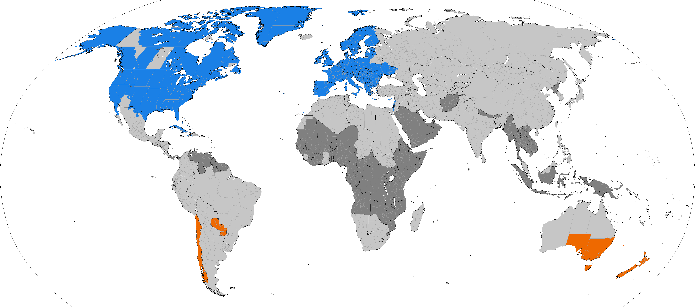
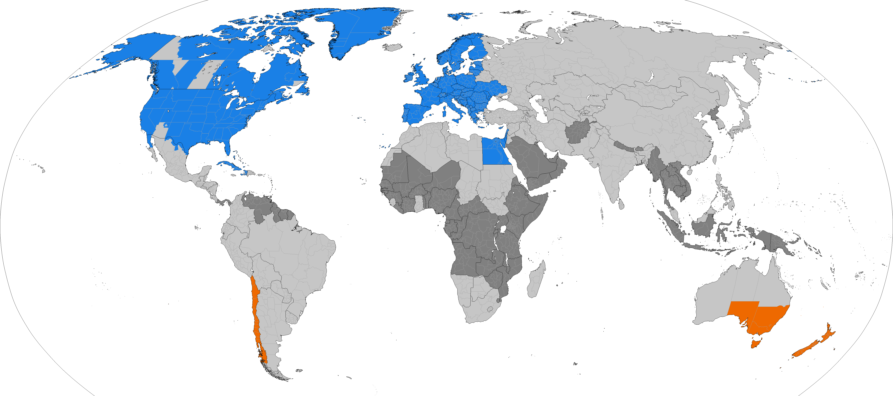
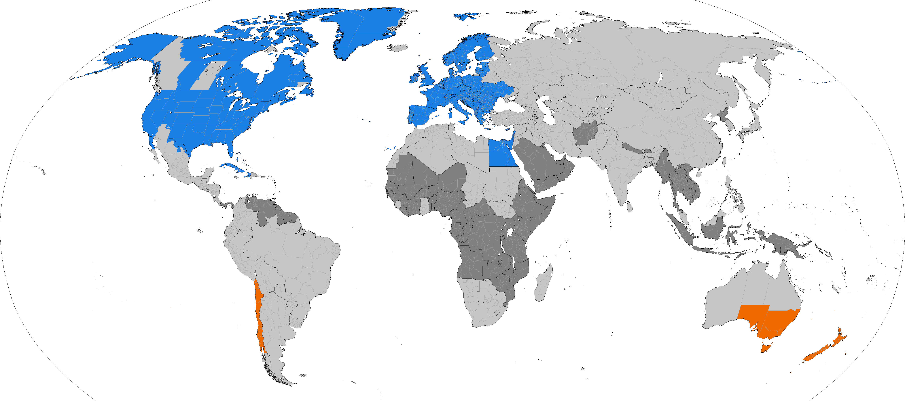

# Les problèmes commencent ...

<ul>
  <li v-click>Heure de livraison : 02 h 30 (du matin), le Dimanche 25 Octobre 2026</li>
  <li v-click>Durée du trajet :
    45 minutes
    <span v-if="$clicks >= 5" class="text-red-500"> ... ou 1 h 45 ???</span>
  </li>
  <li v-click>Heure de départ : 01 h 45</li>
  <li v-click>
    Heure d'arrivée : 02 h 30
    <span v-if="$clicks >= 5" class="font-mono text-amber-400 ml-2">😰 la première ou la seconde ?</span>
  </li>
</ul>

<span v-click class="hidden" />

<v-click>
Que s'est-il passé ?
</v-click>

<v-click>
Décalage horaire : "daylight saving(s) time"
</v-click>

---
layout: center
---

# Avec du code

<v-click>
<!-- -->
</v-click>

```python {0|1-3|1-4|1-5|1-6|all}
import datetime as dt

start_time = dt.datetime(2026, 10, 25, 1, 45, 0)
end_time =   dt.datetime(2026, 10, 25, 2, 30, 0)
duration = end_time - start_time
print(duration)
# 0:45:00
# ... ou 1:45:00 : impossible de le savoir
```

<style>
.slidev-code-dishonored {
  visibility: hidden;
}
</style>

---
clicks: 4
---

# Décalage horaire : automne

<DSTTimelineSVGFall />

---

# Problèmes

<ul>
  <li v-click class="text-orange-400">Non-unicité : DST</li>
</ul>

---

# Avec du code

```bash {1|3|3-4|3-5|3-6|3-7|3-8|8|3-9|3-10}
# run something once every 15 minutes, and compute average speed

# current_time=1:54:17  delta_time=15:00  delta_quantity=147  speed=9.8
# current_time=2:09:17  delta_time=15:00  delta_quantity=147  speed=9.8
# current_time=2:24:17  delta_time=15:00  delta_quantity=147  speed=9.8
# current_time=2:39:17  delta_time=15:00  delta_quantity=147  speed=9.8
# current_time=2:54:17  delta_time=15:00  delta_quantity=147  speed=9.8
# current_time=2:09:17  delta_time=-45:00  delta_quantity=147  speed=-2.66667
# current_time=2:24:17  delta_time=15:00  delta_quantity=147  speed=9.8
# current_time=2:39:17  delta_time=15:00  delta_quantity=147  speed=9.8
```

<style>
.slidev-code-dishonored {
  visibility: hidden;
}
</style>

---

# Problèmes

<ul>
  <li>Non-unicité : DST</li>
  <li v-click class="text-orange-400">Non-monotonicité : DST</li>
</ul>

---

# Et dans l'autre sens

<ul>
  <li v-click>Heure de livraison : 02 h 30 (du matin), le Dimanche 29 Mars 2026</li>
  <li v-click>Durée du trajet :
    45 minutes
    <span v-if="$clicks >= 5" class="text-red-500"> + 1 heure !!!</span>
  </li>
  <li v-click>Heure de départ : 01 h 45</li>
  <li v-click>
    Heure d'arrivée : 03 h 30
    <span v-if="$clicks >= 5" class="font-mono text-amber-400 ml-2">😰</span>
  </li>
</ul>

<span v-click class="hidden" />

<v-click>
Que s'est-il passé ?
</v-click>

<v-click>
02 h 30 n'a pas existé ce jour-là : après 01 h 59, il était 03 h 00
</v-click>

---
layout: center
---

# Avec du code

<v-click>
<!-- -->
</v-click>

```python {0|1-3|1-4|1-5|1-6|all}
import datetime as dt

start_time = dt.datetime(2026, 3, 29, 1, 45, 0)
end_time =   dt.datetime(2026, 3, 29, 3, 30, 0)
duration = end_time - start_time
print(duration)
# 1:45:00
```

<style>
.slidev-code-dishonored {
  visibility: hidden;
}
</style>

---
clicks: 3
---

# Décalage horaire : printemps

<DSTTimelineSVG />

---

# Problèmes

<ul>
  <li>Non-unicité : DST</li>
  <li>Non-monotonicité : DST</li>
  <li v-click class="text-orange-400">Non-continuité : DST</li>
</ul>

---

# Et encore dans l'autre sens

<v-click>
    
</v-click>

---

# Problèmes

<ul>
  <li>Non-unicité : DST</li>
  <li>Non-monotonicité : DST</li>
  <li>Non-continuité : DST</li>
  <li v-click class="text-orange-400">Non-homogénéité : DST</li>
</ul>

---

# Pourquoi s'infliger ça ?

<v-click>

Réponse n°1 : 🛢️ 💲

</v-click>

<v-click>

> Le changement d'heure a été instauré en France à la suite du choc pétrolier de 1973-1974.
> — [service-public.gouv.fr](https://www.service-public.gouv.fr/particuliers/actualites/A18820)

</v-click>

<v-click>

Réponse n°2 : 🌅 ☃️

</v-click>

<v-click>

<WorkAndSchoolSchedule :animated="$clicks >= 8" />

</v-click>

<v-click>
    <SunDuration :x="18" :y="50" :width="28.47" :height="8" label="Solstice d'hiver" color="rgba(147,197,253,0.3)" border="rgba(147,197,253,0.5)" /> <!-- 8h -->
</v-click>
<v-click>
    <SunDuration :x="18" :y="58" :width="35.8" :height="8" label="Aujourd'hui (30 octobre)" color="rgba(134,239,172,0.3)" border="rgba(134,239,172,0.5)" /> <!-- 10h03 -->
</v-click>
<v-click>
    <SunDuration :x="18" :y="66" :width="57" :height="8" label="Solstice d'été" color="rgba(253,224,71,0.3)" border="rgba(253,224,71,0.5)" /> <!-- 16h -->
</v-click>

<span v-click />

<!-- 30 octobre (Paris) : lever 7h32 coucher 17h35 -->

---

# Evolutions

<div class="relative w-full" style="height: 420px">
  <!-- Images at odd clicks: 1, 3, 5, 7, 9, 11, 13 -->
  
  
  
  
  
  

  <!-- Empty steps at even clicks: 2, 4, 6, 8, 10, 12 — add DraggableAnnotations here -->
  <span v-click="2" />
  <DraggableAnnotation v-click="2" :labelX="10" :labelY="46" :tipX="18.5" :tipY="38.5">2022 : Mexico</DraggableAnnotation>
  <span v-click="4" />
  <DraggableAnnotation v-click="4" :labelX="60" :labelY="51.5" :tipX="57" :tipY="43.5">2023 : Egypt</DraggableAnnotation>
  <span v-click="6" />
  <DraggableAnnotation v-click="6" :labelX="52" :labelY="0" :tipX="45.5" :tipY="9">2023 : Greenland</DraggableAnnotation>
  <DraggableAnnotation v-click="6" :labelX="64.5" :labelY="9.5" :tipX="57.7" :tipY="23.7">2023 : Ukraine</DraggableAnnotation>
  <DraggableAnnotation v-click="6" :labelX="47.5" :labelY="69" :tipX="33.5" :tipY="71.5">2024 : Paraguay</DraggableAnnotation>
  <span v-click="8" />
  <DraggableAnnotation v-click="8" :labelX="46.5" :labelY="78.5" :tipX="30.5" :tipY="86.5">2025 : Chile</DraggableAnnotation>
  <span v-click="10" />
  <DraggableAnnotation v-click="10" :labelX="19" :labelY="4" :tipX="19" :tipY="17">2026 : British Columbia</DraggableAnnotation>
  <span v-click="12" />
</div>

---

# Problèmes

<ul>
  <li>Non-unicité : DST</li>
  <li>Non-monotonicité : DST</li>
  <li>Non-continuité : DST</li>
  <li>Non-homogénéité : DST</li>
  <li v-click class="text-orange-400">Non-constance : DST</li>
</ul>

---

# Éviter / détecter (DST) : comparer deux instants

<v-click>
<!-- -->
</v-click>

```python {0|1-6|1-8|1-9|all}
import datetime as dt
from zoneinfo import ZoneInfo
paris = ZoneInfo("Europe/Paris")

start = dt.datetime(2026, 10, 25, 1, 45, tzinfo=paris)
end   = dt.datetime(2026, 10, 25, 2, 30, tzinfo=paris, fold=1)  # 2e passage
print(start)  # 2026-10-25 01:45:00+02:00
print(end)  #   2026-10-25 02:30:00+01:00
print(end - start)  # 0:45:00
utc = dt.timezone.utc
print(end.astimezone(utc) - start.astimezone(utc))  # 1:45:00
```

<v-clicks>

- Dates **avec fuseau** (`zoneinfo`), `fold` pour lever l'ambiguïté, durées calculées **en UTC**
- Tester les heures ambiguës ou inexistantes (changements d'heure), en figeant l'horloge : `time-machine` (slide suivante), `libfaketime`

</v-clicks>

<style>
.slidev-code-dishonored {
  visibility: hidden;
}
</style>

---

# Éviter / détecter (DST) : mesurer une durée

```python
# processus lancé avec TZ=Europe/Paris
import datetime as dt, time, time_machine
from zoneinfo import ZoneInfo
paris = ZoneInfo("Europe/Paris")
before = dt.datetime(2026, 10, 25, 2, 50, tzinfo=paris)         # 02:50 +02:00
after  = dt.datetime(2026, 10, 25, 2, 5, tzinfo=paris, fold=1)  # 02:05 +01:00
```

<div class="grid grid-cols-2 gap-4 mt-2">

<div v-click="1" class="wall">
<div class="text-red-500 font-bold">Horloge murale</div>

```python {0|1|1-3|1-4|all} {at:1}
with time_machine.travel(before) as clock:
    start = dt.datetime.now()
    time.sleep(15 * 60)
    clock.move_to(after)
    delta = dt.datetime.now() - start
    print(delta.total_seconds())
# -2700.0
```

</div>

<div v-click="5" class="mono">
<div class="text-green-500 font-bold">Horloge monotone</div>

```python {0|1-4|all} {at:5}
with time_machine.travel(before) as clock:
    start = time.monotonic()
    time.sleep(15 * 60)
    clock.move_to(after)
    delta = time.monotonic() - start
    print(delta)
# 900.0006…
```

</div>
</div>

<div v-click="7" class="raw mt-2">

```python
print(round(time.monotonic(), 2))  # 24164.39
```

L'horloge monotone n'est pas une date, juste un compteur qui n'avance que vers l'avant.

</div>

<style>
.slidev-code-dishonored {
  visibility: hidden;
}
.wall .line:is(:nth-child(2), :nth-child(5)) > span:nth-child(n+3):nth-child(-n+8),
.mono .line:is(:nth-child(2), :nth-child(5)) > span:nth-child(n+3):nth-child(-n+6),
.raw .line:first-child > span:nth-child(n+5):nth-child(-n+8) {
  font-weight: bold;
}
</style>

---

# Avez-vous remarqué ?

<SunDuration :x="18" :y="25" :width="28.47" :height="8" label="Solstice d'hiver" color="rgba(147,197,253,0.3)" border="rgba(147,197,253,0.5)" /> <!-- 8h -->
<SunDuration :x="18" :y="33" :width="35.8" :height="8" label="Aujourd'hui (30 octobre)" color="rgba(134,239,172,0.3)" border="rgba(134,239,172,0.5)" /> <!-- 10h03 -->
<SunDuration :x="18" :y="41" :width="57" :height="8" label="Solstice d'été" color="rgba(253,224,71,0.3)" border="rgba(253,224,71,0.5)" /> <!-- 16h -->

<!-- pas la même durée -->
