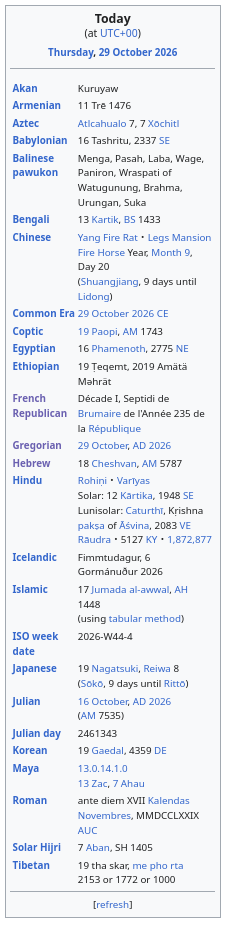

# Le soleil, c'est compliqué

<v-click>
Vraiment très compliqué ...
</v-click>

<v-click>

```python {2|1|3|3,4|3-5|5-6|7|7-8|7-9}
import datetime

today = datetime.date.today()  # 30 octobre 2026
today.replace(month=11)  # 30 novembre 2026
today.replace(month=2)  # ValueError: day 30 must be in range 1..28 for month 2 in year 2026
# ne marche jamais
tomorrow = today + datetime.timedelta(days=1)  # 31 octobre 2026
tomorrow.replace(month=11)  # ValueError: day 31 must be in range 1..30 for month 11 in year 2026
# marche aujourd'hui, mais pas demain
```

</v-click>

<v-click>

site Hugo [grenoble-meetups.fr](https://github.com/Lenormju/grenoble-meetups/commit/61b7a6713590ff2f45eecbea2467a66a66c964c9), bouton « mois suivant » : `$now.AddDate 0 1 0`

le 31 août → « 31 septembre » → 1er octobre

</v-click>

<style>
.slidev-code-dishonored {
  visibility: hidden;
}
</style>

---

# La périodicité naturelle

<ul>
  <li v-click="1">le jour ☀️<span v-click="2">, la nuit 🌌🌙</span></li>
  <li v-click="3">les 4 saisons <span v-click="8" class="no-space-when-hidden">astronomiques </span>: <span v-click="4">🌱</span><span v-click="5">🌻</span><span v-click="6">🍂</span><span v-click="7">🪾</span></li>
  <ul>
    <li v-click="8">les saisons équatoriales: <span v-click="9">🌧️</span><span v-click="10">☀️</span></li>
  </ul>
  <li v-click="11">les années 📆</li>
</ul>

<style>
.no-space-when-hidden.slidev-vclick-hidden {
  display: none;
}
</style>

---

# Oui, mais ...


<ul>
  <li v-click="1">jour solaire ? <span v-click="2">civil ?</span>
    <ul>
      <li v-click="3">jour solaire : centré sur midi solaire (zénith)</li>
      <li v-click="4">aujourd'hui le 30 octobre : 7:32 (CET) --> 17:35 (CET)</li>
      <li v-click="5">donc midi solaire à (7:32+17:35)/2 = 12:33 (CET)</li>
      <li v-click="6">donc midi solaire à pas du tout "midi"</li>
    </ul>
  </li>
  <li v-click="7">année tropicale ? <span v-click="8">sidérale ?</span> <span v-click="9">civile ?</span>
    <ul>
      <li v-click="10">tropicale (retour du soleil au même point dans le ciel) : ~365.24219 jours "éphémérides" <span v-click="11">(2000)</span></li>
      <li v-click="12">sidérale (retour de la Terre au même point sur son orbite) : 365.256363 jours <span v-click="13">(2025)</span></li>
      <li v-click="14">différence de ~20 minutes et 24.7 seconds</li>
      <li v-click="15">anodin ?</li>
    </ul>
  </li>
</ul>

---
class: no-center
---

# Une histoire de chocolat ?

<v-clicks depth="2">

* Jésus-Christ a ressuscité <sup class="citation-needed">&#91;citation needed&#93;</sup>
  * les chrétiens ont souhaité commérer cette date
  * 1er dimanche après la pleine lune après le 21 Mars (approximation de l'équinoxe de Mars)
  * date mouvante = 😬
* le calendrier Julien supposait qu'une année faisait exactement 365.25 jours
  * année tropicale ≈ 365.2422
  * les dates dérivent : le 21 Mars ne colle plus à l'équinoxe !
  * 1545 : on souhaite revenir à la « vraie » date qu'il était en l'an 325
* calendrier Grégorien !
  * transition : 10 jours sautés d'un coup<br />
    <CalendarCorrespondence />
  * année = 365.2425
  * année = 365 ou 366 jours ?

</v-clicks>

<!--
je vous passe les controverses sur comment calculer la date, ni les schismes religieux, ...
je ne vous parle pas non plus du calendrier juif, encore utilisé au début de l'ère chrétienne, qui est lunisolaire
-->

<style>
.citation-needed {
  color: #3366cc;
  font-size: 0.75em;
  white-space: nowrap;
  font-weight: normal;
}
li {
  line-height: 1.5em;
}
</style>

---

# Quiz !

<v-click>

1. Règle pour les années bissextiles ❓

</v-click>

<v-clicks>

* divisible par 4
* mais **pas** par 100
* mais quand même par 400

</v-clicks>

<v-click>

2. Pourquoi "bissextile" ❓

</v-click>

<v-clicks>

* car dans le calendrier Julien il s'insérait après le 24 Février
* > ante diem bis sextum Kalendas Martias
* > le sixième jour bis avant les calendes (le premier jour) de mars

</v-clicks>

<v-click>

ℹ️ En anglais : "leap years"

</v-click>

<v-click>

3. Année civile basée sur : tropicale ou sidérale ❓

</v-click>

<v-clicks>

* tropicale
* on aime les équinoxes constants à travers les siècles (🤨)

</v-clicks>

---

# Problèmes

<ul>
  <li>Non-unicité : DST</li>
  <li>Non-monotonicité : DST</li>
  <li>Non-continuité : DST</li>
  <li>Non-homogénéité : DST</li>
  <li>Non-constance : DST<span v-click>, <span class="text-orange-400">leap years</span></span></li>
</ul>

---

# Les constantes qui ne le sont pas

<Skip hard />

<v-clicks depth="2" class="tight-list">

* ☪️ Musulman (Hijri / Hégirien / "islamic") :
  * lunaire ("basé sur la lune")
  * la lune n'a pas une période synodique de X jours exactement (~29.53)
  * année de 12 mois lunaires : 354 ou 355 jours
  * (6×29 + 6×30 = 354 ; 5×29 + 7×30 = 355)
  * les saisons tournent sur 33 ans
* ✡️ Juif (hébraïque / "hebrew") :
  * mois luni-solaires "intercalaires" pour approximer l'année tropicale
  * un mois supplémentaire tous les 2 ou 3 ans
  * cycle métonique : 7 mois en 19 ans
* ☦️ Orthodoxe :
  * resté sur le calendrier Julien
  * 13 jours de retard (non-rattrapés par le passage au Grégorien)
  * règle des bisextiles Julien : simplement divisible par 4
* calendriers 🕉️ bouddhiste, 🐉 chinois, 🕉️ hindou, ...

</v-clicks>

<div v-click="[16, 17]" class="fixed inset-0 z-[999] flex items-center justify-center bg-black/80">
  
</div>

<v-click :at="17">

Le calendrier ✝️ grégorien est le standard dans l'industrie occidentale.

</v-click>

<!--
Image des calendriers : https://en.wikipedia.org/wiki/Calendar_date
-->

<style>
.tight-list li {
  margin-top: 0.15em;
  margin-bottom: 0.15em;
  line-height: 1.3;
}
.tight-list ul {
  margin-top: 0.1em;
  margin-bottom: 0.1em;
}
</style>

---

# Problèmes

<ul>
  <li>Non-unicité : DST</li>
  <li>Non-monotonicité : DST</li>
  <li>Non-continuité : DST</li>
  <li>Non-homogénéité : DST<span v-click>, <span class="text-orange-400">leap years</span></span></li>
  <li>Non-constance : DST, leap years</li>
</ul>

---

# Des solutions ?

<div class="grid grid-cols-2 gap-8 mt-4">
  <div class="flex flex-col items-center">
    <LightboxImage v-click src="/images/Symmetry454 calendar.png" class="h-40 object-contain" />
    <div class="mt-3 text-center">
      <p v-click>Symmetry 454</p>
      <p v-click>Semaine intercalaire !! 😭</p>
      <p v-click>(52 × année + 146) mod 293 &lt; 52 😵</p>
    </div>
  </div>
  <div class="flex flex-col items-center">
    <LightboxImage v-click src="/images/Deuxième_partie_d’un_calendrier_de_1801-1802,_avec_les_correspondances_grégoriennes,_orné_de_signes_allégoriques,_G.29855.jpg" class="h-40 object-contain" />
    <div class="mt-3 text-center">
      <p v-click>L'égalité ou rien !</p>
      <p v-click>12 mois de 30 jours ...</p>
      <p v-click>+ 5 jours épagomènes ("supplémentaires") "sansculottides" tous les ans
        <br/>+1 jour "sextile" tous les 6 ou 7 ans.</p>
    </div>
  </div>
</div>

<v-click>

<p class="text-center">Bien d'autres ... mais <strong class="text-4xl font-black">impossible de faire parfait</strong>.</p>

</v-click>

<style>
.tight-list li {
  margin-top: 0.15em;
  margin-bottom: 0.15em;
  line-height: 1.3;
}
.tight-list ul {
  margin-top: 0.1em;
  margin-bottom: 0.1em;
}
</style>

<!--
jours épagomènes, cf calendrier égyptien antique
-->

---

# De vraies solutions

<v-click>

> Temporal [...] learned from the many failures and dead bodies that came before it. And it had lots of good implementations to look at: Joda Time, Chrono, etc.
> -- [news.ycombinator.com](https://news.ycombinator.com/item?id=46597195)

</v-click>

<v-clicks depth="2">

* ajouter une **durée "claire"** : un nombre fixe de secondes → `timedelta(days=1)`
* ajouter une **durée "ambigüe"** : « +1 mois », « +1 an », longueur variable
  * une API qui accepte la réalité des calendriers : `relativedelta`, `Temporal.PlainDate.add`, Java `plusMonths`, SQL `interval '1 month'`
  * jamais de `replace(month=...)`, ni d'arithmétique à la main
* tester : 28 et 29 février, le 31, 1900 / 2000 / 2100 ... et en property-based

</v-clicks>

---

# +1 mois, le 31 octobre 2026

<div class="grid grid-cols-2 gap-4 mt-2">
<div v-click>

Python : plante

```python
d = date(2026, 10, 31)
d.replace(month=11)  # ValueError: day 31 must be in range 1..30
d + relativedelta(months=1)  # 2026-11-30
```

</div>
<div v-click>

JavaScript : déborde en silence

```js
const d = new Date(2026, 9, 31)  // mois de 0 à 11
d.setMonth(10)  // "Tue Dec 01 2026", donc month=11 !!
```

</div>
<div v-click>

Go : déborde en silence

```go
d := time.Date(2026, 10, 31, 0, 0, 0, 0, time.UTC)
d.AddDate(0, 1, 0)  // 2026-12-01
```

</div>
<div v-click>

Temporal : écrête, ou rejette sur demande

```js
const d = Temporal.PlainDate.from("2026-10-31")
d.add({ months: 1 })  // 2026-11-30
d.add({ months: 1 }, { overflow: "reject" })  // RangeError
```

</div>
</div>

<v-click>

<p class="text-center text-xl mt-4">Un résultat faux <strong>silencieux</strong> est pire qu'une erreur.</p>

</v-click>

<v-click>

<p class="text-center mt-2">« +1 mois » d'une échéance, « +1 an » un 29 février : <strong>règle métier explicite</strong>, dernier jour du mois ou jour écrêté ?</p>

</v-click>

<!--
même bug que la slide d'ouverture (replace(month=...)) : Python plante, Go et JS débordent
c'est la règle d'écrêtage de Temporal : à choisir et à documenter, pas à subir
-->
