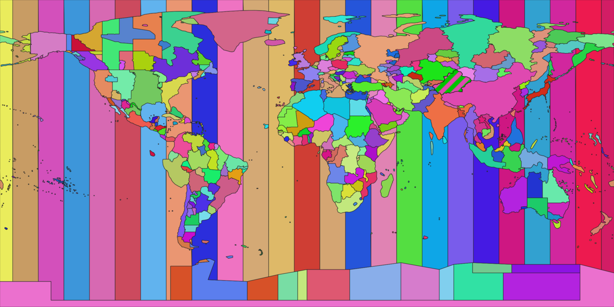
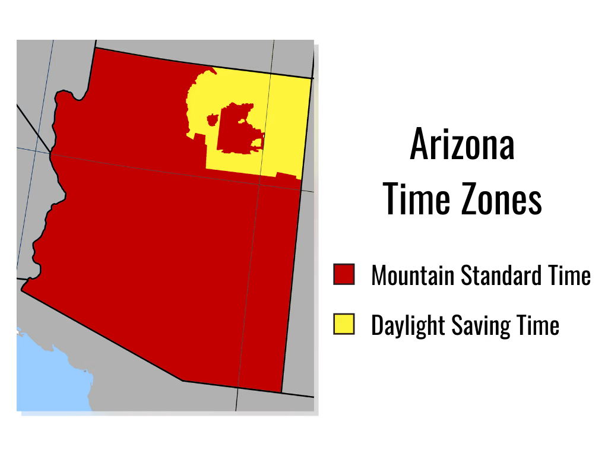
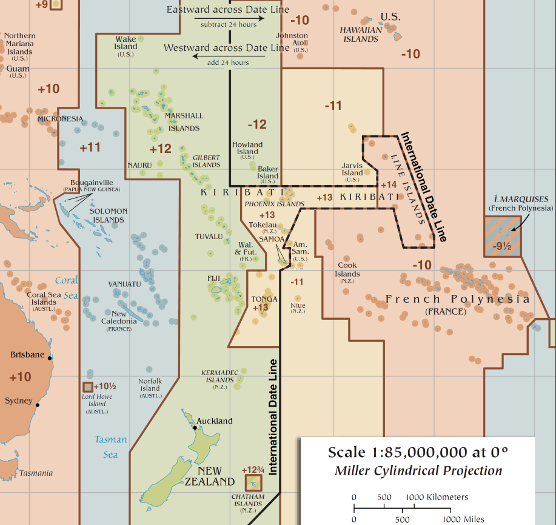

# L'histoire des timezones

<v-click>
Pour faire (très) court :
</v-click>

<v-clicks depth="2">

* avant, le temps était très local
  * on suivait principalement le soleil
  * chaque ville avait son heure
  * on voyageait lentement
* puis les trains ont tout chamboulé
  * (les accidents mortels ont contribué)
* on a décidé d'unifier le temps, progressivement
* (je passe l'histoire chaotique pour chaque pays)
* aujourd'hui, le monde entier est découpé en timezones clairement définies

</v-clicks>

---

---

# Bases et exemples

<v-clicks depth="2" class="tight-list">

* "prime meridian" (IERS Reference Meridian) : Greenwich
  * (je vous passe l'histoire de Greenwich)
  * **a servi à définir UTC**
  * (je vous passe l'histoire d'UTC)
  * UTC = Universel Temps Coordonné / Universal Time Coordinated
* changement d'heure :
  * avant le 25 octobre : European Central Summer Time (ECST, UTC+2)
  * après le 25 octobre : European Central Time (ECT, UTC+1)
* voyage au Royaume-Uni :
  * UK suit le Greenwich Mean Time (GMT, UTC) ou le British Summer Time (BST, UTC+1)
  * a conservé son changement d'heure synchronisé avec le reste de l'Union Européenne
  * à l'aller je "perds" 1h, au retour je la regagne
* "offset" versus "zoned" :
  * China Standard Time (CST) = `+08:00` ou `Asia/Shanghai`
  * Eastern Standard Time (EST) = `-05:00` ou `America/Cancún`
* ni offset ni timezone = "naïve"

</v-clicks>

---

# Un sacré bazar !

<v-clicks depth="2">

* maintenu par l'IANA ("Internet Assigned Numbers Authority", filiale de l'ICANN), aussi connue pour :
  * les DNS root zones
  * les plage d'IP addresses
  * les AS numbers
  * servir de registry pour certains protocoles (port numbers, HTTP status codes, TLS cypher suites, DNS root zones, jeux de caractères pour `Content-Type` UTF-8, ISO-8859-1, ...)
* "IANA Time Zone Database" ou "tz" ou "tzinfo"
  * format riche
  * données historiques
  * mise-à-jour rapide
* inclus dans les OS
* inclus dans les libs des langages de programmation
* à mettre à jour régulièrement

</v-clicks>

---

# Un bazar infini !

  
  

<!--
International date line :
* discontinuité de 24 heures (changement de jour)
* demi-heure
* trois-quart d'heure (rare !)
* kiribati -11/-10 devenu +13/+14
-->

---

# Problèmes

<ul>
  <li>Non-unicité : DST, timezones</li>
  <li>Non-monotonicité : DST, timezones</li>
  <li>Non-continuité : DST, timezones</li>
  <li>Non-homogénéité : DST, leap years, timezones</li>
  <li>Non-constance : DST, leap years, timezones</li>
  <li>Non-standardized : dates and time formats</li>
</ul>

---

# Conseils : stocker et conserver

<v-clicks>

* saisie utilisateur : datetime dans le bon fuseau (zoned)
  * obligatoire, jamais de datetime "naïf" !
* convertir en 2 valeurs distinctes : datetime en UTC + fuseau voulu
  * (noter la version de tzdata utilisée pour le calcul)
* faire toutes les opérations sur la valeur UTC
* à la présentation, reconvertir la valeur UTC dans le fuseau voulu

</v-clicks>

<!--
bases de données : le fuseau n'est presque jamais conservé (`timestamptz` le perd), il faut le stocker sans support natif
-->

---

# Conseils : l'intention versus l'offset

<v-clicks>

* l'intention : « 10h à Mexico City » = une heure + un lieu
* un offset (`-05:00`) est un résultat calculé, pas une intention
* une zone stocke un lieu plutôt qu'une valeur : bien plus stable
* l'UTC est un cache dérivé : le garder, mais le recalculer quand tzdata change
  * recalculer les événements postérieurs à la date d'effet de la règle (+ valeurs dérivées : compteurs à rebours…)
  * métier : décider quoi faire des événements déplacés ou déjà déclenchés à la mauvaise heure
* échanger : RFC 9557 (2024), `2027-03-03T09:00+01:00[Europe/Paris]`, support parcellaire

</v-clicks>

<!--
Mexique, tzdata 2022f (28/10/2022) : le DST est abrogé, 2 jours de préavis pour Chihuahua.
10 h à Mexico le 12/04/2023 = 15:00 UTC avec tzdata 2022e, 16:00 UTC avec 2022f.
L'UTC stocké en 2022 est faux d'une heure, l'intention (10 h + zone) reste juste.
Pourquoi garder l'UTC : les bases ne gardent presque jamais la zone (PostgreSQL, MySQL, MongoDB, SQL Server ; seul Oracle garde la région),
et chaque couche a sa copie de tzdata (MySQL : rechargement manuel + redémarrage ; JVM : redémarrage ; zoneinfo : cache).
RFC 9557 : stdlib Python ne le supporte pas, Temporal / Java / whenever oui. Z = instant connu, offset inconnu ; +00:00 n'est pas un fuseau (Londres l'hiver).
-->

---

# Quand tzdata change : des questions à trancher

* Intention (heure + zone)
* Eancien et Enouveau : UTC calculé avec l'ancienne et la nouvelle tzdata
* U : instant de la mise à jour.

| Eancien | Enouveau | Cas | Réaction |
|---|---|---|---|
| après U | après U | encore à venir | règle métier : replanifier |
| avant U | avant U | déjà passé | règle métier : logger |
| avant U | après U | le passé repasse dans le futur | règle métier : alerter |
| après U | avant U | le futur devient passé | règle métier : manqué |

<v-click>

* fait observé (log, paiement) : l'UTC est le fait, on ne le recalcule jamais
* mise à jour avant la date d'effet : seul le premier cas existe
* une heure locale peut devenir inexistante ou ambiguë : Python choisit `fold=0` sans rien dire

</v-click>

<!--
Mexique, tzdata 2022f : 10 h à Mexico le 12/04/2023 = 15:00Z (2022e) puis 16:00Z (2022f), l'événement recule ; U = 12/04 15:30Z → le passé repasse dans le futur.
Égypte, tzdata 2023a : 10 h au Caire le 15/06/2023 = 08:00Z (2022g) puis 07:00Z (2023a), l'événement avance ; U = 15/06 07:30Z → le futur devient passé.
Date d'effet D = premier instant (UTC) où l'ancienne et la nouvelle règle donnent un décalage différent (Mexique : 2023-04-02 08:00Z, pas la date de la loi). Les cas 2 à 4 n'existent que si U est après D.
Les cas 3 et 4 ne concernent que les événements à moins de Δ (ampleur du décalage, 1 h ici) de U. Le vrai dégât : tous les événements entre D et U ont déclenché leurs alertes à la mauvaise heure.
Heure inexistante : Le Caire, 28/04/2023 00:30 (tzdata 2023a saute de 00:00 à 01:00) ; fold=0 → 22:30Z, fold=1 → 21:30Z, avant D.
Heure ambiguë : Kazakhstan, tzdata 2024a (01/02/2024) : Almaty passe de +06 à +05 le 01/03/2024 à 00:00 ; 29/02/2024 23:30 : fold=0 → 17:30Z (+06), fold=1 → 18:30Z (+05). Python ne lève aucune erreur ; Temporal : `disambiguation: 'reject'`.
Corrections rétroactives de l'historique : Colombie (2022g), 12:00 le 01/03/1993 → 16:00Z puis 17:00Z ; Vietnam (2024a).
Ne pas filtrer par `UTC_cache > now()` (rate le cas 3, recalcule le cas 4 en silence). Détails et sources : HANDOFF_05_conseils_stockage.md.
-->

---

# Petit bonus : décalage solaire

<v-click>

<ZoomableImage src="/images/solartimevsstandardtime.png" :initial-scale="0.5" />

</v-click>
