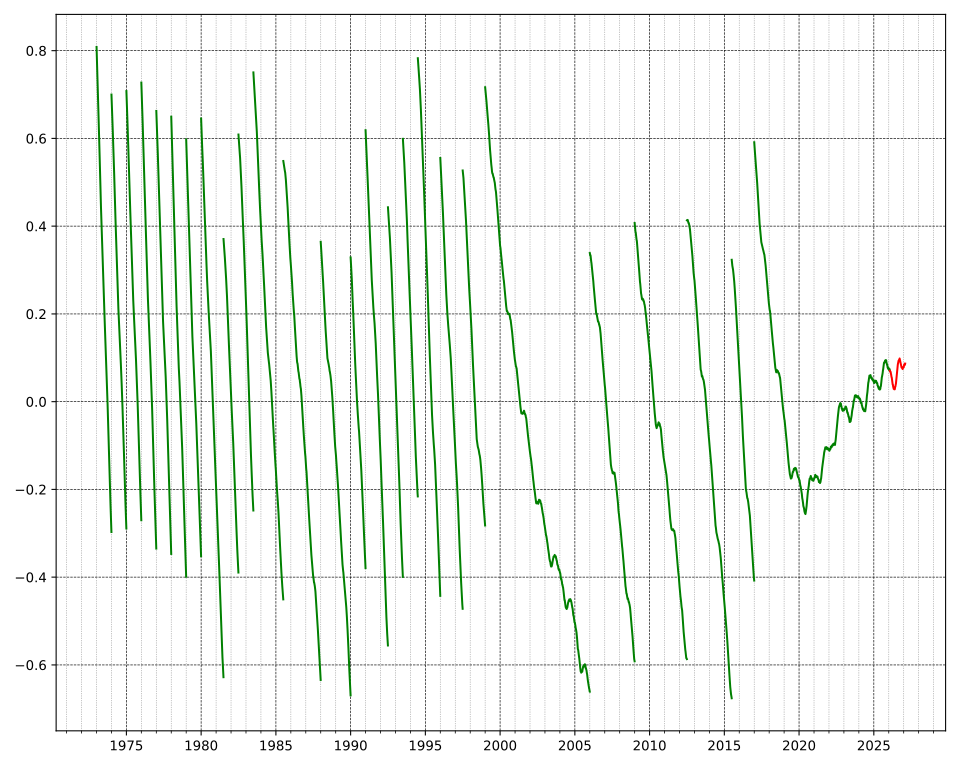

# Sans transition, les secondes !

<v-clicks>

* <LocalTimeOffset />
* rien de plus simple : une toutes les secondes
* wait ...
* la seconde c'est l'unité SI de référence du temps
* > la durée d'un nombre entier d'oscillations (9 192 631 770 exactement) liées à la fréquence de transition hyperfine de l'atome de césium 133
  -- [wikipedia.org](https://fr.wikipedia.org/wiki/Seconde_(temps))
* mesuré à partir d'horloges "atomiques"
* on obtient le TAI : Temps Atomique International
* ➡️ quelle différence avec UTC ?

</v-clicks>

---

# Le retour de la cosmologie !

<Skip hard />

<v-clicks>

* il faut d'abord parler de UT(1), et donc de UT0 ...
* à la base il y avait "GMT", différent de "GMT" (UTC+0)
* utilisé par les astronomes : chaque jour va de midi à midi, pour bosser la nuit
* transition à un calendrier minuit-minuit : 
  Midi 31/12/1925 des astronomes devint minuit 31/12/1925
* renommé en UT
* devenu UT0 quand on a introduit UT1
* (UT1 prend en compte une correction du mouvement polaire)
* (je passe sur UT2)
* UT1 sert à calculer UTC

</v-clicks>

---

# Et du coup c'est quoi une seconde UTC ?

<v-clicks>

* une seconde UT1 est une fraction (1/86400) de la durée de rotation entre deux zéniths
* mais la Terre n'a pas une rotation constante 
  (forces de marées, convection du noyau, fonte glaciaire, gros séismes, ...)
* donc les secondes UT1 n'ont pas une durée constante par rapport à celles TAI
* or les secondes UTC sont des secondes TAI
* et UTC doit garantir $|\text{UTC} - \text{UT1}| < 0.9$
* donc c'est le nombre de secondes par jour qui change !
* 86400 ± 1
* seconde intercalaire ! ("leap second")

</v-clicks>

  

---

# Problèmes

<ul>
  <li>Non-unicité : DST, timezones, leap seconds</li>
  <li>Non-monotonicité : DST, timezones, leap seconds</li>
  <li>Non-continuité : DST, timezones, leap seconds</li>
  <li>Non-homogénéité : DST, leap years, timezones, leap seconds</li>
  <li>Non-constance : DST, leap years, timezones, leap seconds</li>
  <li>Non-standardized : dates and time formats, leap seconds</li>
</ul>

---

# La fin des secondes intercalaires

**Breaking news** : 15 octobre 2026, CGPM, Résolution 5 : « On the technical actions needed to ensure the continuity of UTC »

<v-clicks>

- UTC continu à partir du **20 mai 2027** : plus de seconde intercalaire !
- $UT1 − UTC$ pourra dériver jusqu'à **1 heure** (au lieu de 0,9 s)
- Dernière seconde intercalaire en date : 31 décembre 2016.
- désormais $TAI − UTC = 37 s$

</v-clicks>

<v-click>

🎉 🥳 🍾 🎊

</v-click>

<!--
Sources :
* BIPM (Résolution 5 de la 28e Conférence générale des poids et mesures (CGPM), 15 oct. 2026) : https://www.bipm.org/en/cgpm-2026/resolution-5
* IERS Bulletin C 72 pour les 37 s : https://datacenter.iers.org/data/16/bulletinc-072.txt
-->

---
clicks: 10
class: no-center
---

# Et comment ça ~~fonctionne~~ fonctionnait ?

<Skip hard />

<v-click>

 <!-- to to make it a subtitle -->
Ca dépend !

</v-click>

<v-click>

1. Ajout d'une seconde :

<LeapSecondTimelineSVG />

</v-click>

<v-click>

2. Smearing d'une seconde :

<LeapSecondSmearingTimelineSVG />

</v-click>

<v-click>

3. Répétition d'une seconde :

<LeapSecondRepeatTimelineSVG />

</v-click>

<!--
Qui fait quoi (au passé : dernière seconde intercalaire le 31 décembre 2016) :
* Smearing :
  * Google : linéaire sur 24 h, de midi à midi UTC (le cosinus n'a servi qu'en 2008) : https://developers.google.com/time/smear
  * AWS : 24 h autour de la seconde (NTP / Amazon Time Sync lissé), MAIS l'horloge matérielle PTP d'EC2 ajoute la seconde sans lisser : https://aws.amazon.com/blogs/aws/look-before-you-leap-the-coming-leap-second-and-aws/ et https://docs.aws.amazon.com/AWSEC2/latest/UserGuide/set-time.html
  * Meta : 17 h, quadratique, à partir de 00:00 UTC : https://engineering.fb.com/2022/07/25/production-engineering/its-time-to-leave-the-leap-second-in-the-past/
  * écart jusqu'à ±0,5 s par rapport à UTC pendant le lissage, et les smears de fournisseurs différents divergent entre eux
* Répétition : le noyau Linux par défaut recule l'horloge d'une seconde (`kernel/time/ntp.c`, `STA_INS` dans `adjtimex`). POSIX compte 86400 s par jour, pas de 60, et laisse le comportement à l'implémentation. chrony : `leapsecmode` = `system` (défaut), `step`, `slew`, `ignore`
* Ajout (23:59:60) : c'est la définition de l'UTC (IERS Bulletin C), mais très peu d'API l'exposent (le noyau ne renvoie jamais 60 dans `time_t`, `CLOCK_TAI` donne un temps continu)
* Rien d'établi sur Azure, Windows, Alibaba (ne pas les citer)

Code qui casse sur 23:59:60 (exécuté pour de vrai : Python 3.14.3, Node 20, Node 26.12.1) :
* Python : `datetime(2016,12,31,23,59,60)`, `time(23,59,60)` et `datetime.strptime("23:59:60","%H:%M:%S")` lèvent `ValueError` (second must be in 0..59, not 60)
* JS : `new Date("2016-12-31T23:59:60Z")` donne « Invalid Date » ; `Date.UTC(2016,11,31,23,59,60)` déborde vers 2017-01-01T00:00:00.000Z
* Temporal (natif dans Node 26 seulement) accepte `:60` et le ramène silencieusement à 59 : aucune représentation de la seconde intercalaire

Bugs réels :
* Cloudflare, 1er janvier 2017 00:00 UTC (jusqu'à ~06:45 UTC) : RRDNS (Go) fait `rtt := time.Now().Sub(start)`, l'horloge recule, RTT négatif, la moyenne lissée négative est passée à `rand.Int63n()` qui panique ; le `recover` rattrape la panique mais les résolutions DNS échouent. Impact partiel : clients utilisant des CNAME, ~0,2 % des requêtes DNS au pic, <1 % des requêtes HTTP en erreur. NE PAS dire « hors service ». Cause citée par Cloudflare : « the belief that time cannot go backwards ». Avant Go 1.9, `time.Now()` n'était pas monotone (l'horloge monotone l'aurait évité). La version de Go de Cloudflare n'est pas indiquée : ne pas l'affirmer. https://blog.cloudflare.com/how-and-why-the-leap-second-affected-cloudflare-dns/
* Linux, 30 juin 2012 : le noyau n'appelait pas `clock_was_set()` après l'insertion de la seconde (appel retiré en 2007, code non exercé depuis la seconde de fin 2008). Les hrtimers étaient en avance d'1 s sur l'horloge, les timers absolus `CLOCK_REALTIME` < 1 s (ex. timeouts de `futex_wait`) expiraient aussitôt, d'où des pics de charge CPU ; `settimeofday()` débloquait. Victimes sourcées : Reddit (Cassandra), Mozilla (Hadoop), Qantas (Wikipedia). Java, MySQL, LinkedIn : non vérifiés, ne pas les citer. Correctif de John Stultz (juillet 2012, commit bb88e92477de) ; deuxième bug distinct : livelock hrtimer / xtime_lock dans `do_adjtimex`
-->
