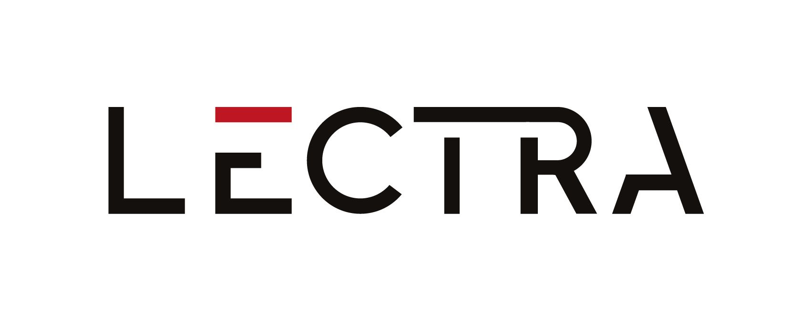
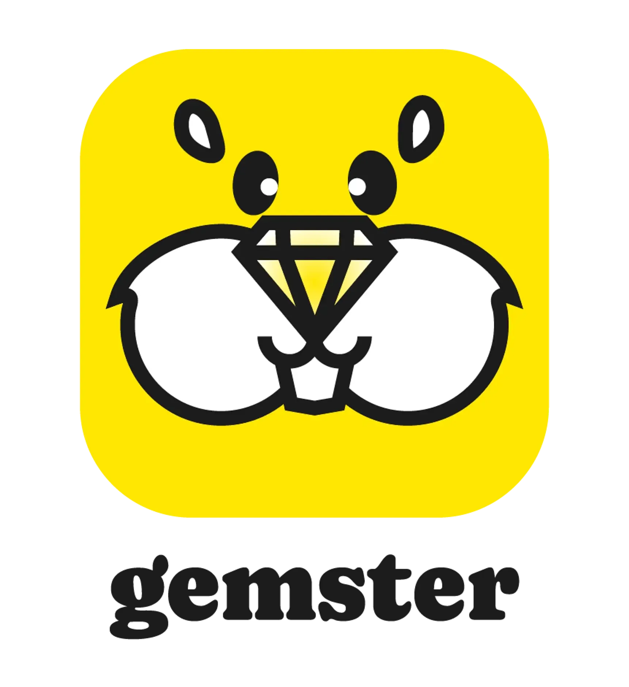

# Le temps c'est de l'argent ...  et des bugs aussi !

---
layout: default
class: text-center sponsors-bdxio
---

# Nos sponsors BDX I/O 2026

Merci à eux !

  

    
Balthazar

    

    
    

  

  

    
Impériale

    

    
    
    
    
    
    
    
    
    
    

  

  

    
Magnum

    

    
    
    
    

  

  

    
Startup

    

    
    
    
    
    
    
    
    
    

  

---
src: ./pages/01-intro.md
---

IMPORTED

---
src: ./pages/02-dst.md
---

IMPORTED

---
src: ./pages/03-days-and-years.md
---

IMPORTED

---
src: ./pages/04-formats-and-standards.md
---

IMPORTED

---
src: ./pages/05-timezones.md
---

IMPORTED

---
src: ./pages/06-seconds.md
---

IMPORTED

---
src: ./pages/07-timekeeping.md
---

IMPORTED

---
src: ./pages/08-politics.md
---

IMPORTED

---
src: ./pages/18-conclusion.md
---

IMPORTED

---
src: ./pages/19-outro.md
---
